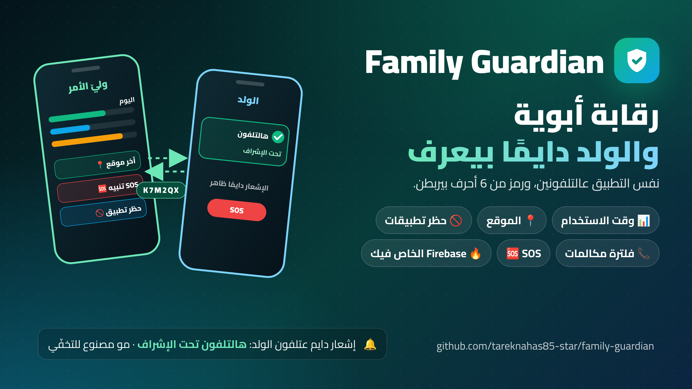

# Family Guardian

**Parental control for Android. One app, two modes, and the child always knows.**
**رقابة أبوية لأندرويد. تطبيق واحد، وضعين، والولد دايمًا بيعرف.**



**[⬇️ Download latest APK](https://github.com/tareknahas85-star/family-guardian/releases/latest/download/family-guardian.apk)** &nbsp;|&nbsp; **[⬇️ حمّل آخر نسخة APK](https://github.com/tareknahas85-star/family-guardian/releases/latest/download/family-guardian.apk)**

[English](#in-english) &nbsp;·&nbsp; [بالعربي](#بالعربي) &nbsp;·&nbsp; [Setup · الإعداد](docs/SETUP.md) &nbsp;·&nbsp; [Privacy · الخصوصية](docs/PRIVACY.md)


---

## In English

A parental control app for Android. One APK, two modes: **Parent** and **Child**.

You install the same app on both phones. On your phone you choose Parent. On your
child's phone you choose Child. A 6-letter pairing code links them.

From your phone you can:

- see how long each app was used today
- block apps, or give an app a daily time limit
- turn the child's internet on or off
- lock the child's phone
- see the child's last location
- see the call log (numbers and times, not the sound)
- block calls from unknown numbers, and get an alert with the number
- get an alert when the child leaves a safe place, like home or school
- set rules by time of day, like bedtime or study time
- get an SOS alert with the location when the child presses the panic button

**The child always knows.** Their phone shows a notification all the time that
says the phone is supervised. This app is not made to hide.

### Status

It works, but it is a personal project. It is not on Google Play. You build the
APK yourself, or download it from the
[latest release](https://github.com/tareknahas85-star/family-guardian/releases/tag/latest).

### How it works

Both phones talk to **your own** Firebase Realtime Database. Nothing goes to any
other company's server.

```
  Parent phone                Firebase                     Child phone
 ┌──────────────┐        /devices/{CODE}/              ┌──────────────────┐
 │ commands  ───┼──────►  commands/  ◄─────── reads ───┤ MonitorService   │
 │ policy    ───┼──────►  policy/    ◄─────── applies ─┤  every minute    │
 │ reports   ◄──┼──────   reports/   ◄─────── writes ──┤                  │
 │ alerts    ◄──┼──────   alerts/    ◄─────── writes ──┤                  │
 └──────────────┘                                      └──────────────────┘
```

The parent writes a *policy*: what is blocked, what the limits are, where the safe
places are. The child app reads that policy every minute, applies it, and writes
back usage, location and call data. It also keeps a service running in the
background so it still works after the phone restarts.

More detail: [docs/ARCHITECTURE.md](docs/ARCHITECTURE.md)

### Setup

Full guide: **[docs/SETUP.md](docs/SETUP.md)**

Short version:

1. Create a free Firebase project. Put its `google-services.json` in `app/`.
2. In Firebase, turn on **Anonymous** sign-in.
3. Copy [`database.rules.json`](database.rules.json) into the Realtime Database
   rules page. **Do not skip this step.** Without it, anyone who knows your
   database address can read your child's location.
4. Build the APK. Install it on both phones.
5. On the parent phone, copy the pairing code. Press "Open pairing window".
6. On the child phone, type the code, then give the permissions in order.

To make the app impossible to remove you need one extra step from a computer. It
is explained in the setup guide.

### About call filtering

This blocks calls from numbers that are not in the child's contacts and not on
your allow list. You get a notification with the number that called.

Two important points:

- **Emergency numbers are never blocked.** No setting can change that. The check
  happens before any other rule, so a wrong allow list can never stop a child
  from calling for help.
- It needs **Android 10 or newer**, and the user must approve it in a system
  dialog. Android does not let an app give itself this permission. Only one app
  on a phone can filter calls, so turning it on here turns it off in Truecaller
  or any similar app.

**There is no Truecaller API to look up who owns a number.** Their public SDK only
confirms that a person owns the number they typed, as a way to log in. So names
come from the phone's own contact list. The alert has a button that opens the
number inside the Truecaller app, if you have it installed.

### What this app cannot do

- **Record calls.** Android blocked this years ago. No app can do it.
- **Read WhatsApp or SMS messages.** Not supported, and not planned.
- **Hide from the child.** This is on purpose. See
  [docs/PRIVACY.md](docs/PRIVACY.md).
- **Stop uninstall without a computer.** Device Admin alone can be switched off
  by the child. Real protection needs Device Owner, which needs one command from
  a PC on a phone that was just factory reset.

### What you need

- Two Android phones, **Android 8 or newer** (Android 10+ for call filtering)
- A free Firebase project
- A computer with ADB, only for the Device Owner step

### Project layout

```
app/src/main/java/com/tarek/guardian/
├── ui/         role select · parent dashboard · child setup · settings · about
├── admin/      device admin receiver · policy manager (Device Owner)
├── monitor/    background service · usage · app blocking · safe zones ·
│               schedules · SOS · call log · location · boot
├── calls/      call filtering: screening service · decision rules · caller id
├── alerts/     parent notifications
├── work/       weekly report
├── vpn/        internet on/off switch
├── fcm/        push wake-up
└── data/       models · Firebase access
```

### Legal

Use this for **your own child under 18, and tell them.** Installing it on an
adult's phone without their knowledge is illegal in most countries. Details in
[docs/PRIVACY.md](docs/PRIVACY.md).

### Built with

Kotlin, View Binding, Firebase Realtime Database and Authentication, Firebase
Cloud Messaging, WorkManager, `AccessibilityService`, `DevicePolicyManager`,
`CallScreeningService`, and a local `VpnService` for the internet switch.
GitHub Actions builds the APK on every push.

---

## بالعربي

تطبيق رقابة أبوية لأندرويد. ملف APK واحد، وضعين: **وليّ الأمر** و**الولد**.

بتثبّت نفس التطبيق عالتلفونين. عتلفونك بتختار وليّ الأمر. وعتلفون ولدك
بتختار الولد. وبيربط بينهن رمز اقتران من 6 أحرف.

من تلفونك بتقدر:

- تشوف قديش انستخدم كل تطبيق اليوم
- تحظر تطبيقات، أو تعطي تطبيق حد زمني يومي
- تشغّل إنترنت الولد أو توقفو
- تقفل تلفون الولد
- تشوف آخر موقع للولد
- تشوف سجل المكالمات (الأرقام والأوقات، مو الصوت)
- تحظر المكالمات من الأرقام المجهولة، مع تنبيه فيو الرقم
- يجيك تنبيه لما الولد يطلع من مكان آمن، متل البيت أو المدرسة
- تضبط قواعد حسب وقت النهار، متل وقت النوم أو وقت الدراسة
- يجيك تنبيه استغاثة (SOS) مع الموقع لما الولد يدوس زر الطوارئ

**الولد دايمًا بيعرف.** تلفونو بيعرض إشعار طول الوقت بيقول إنو التلفون تحت الإشراف.
هاد التطبيق مو مصنوع للتخفّي.

### الحالة

شغّال، بس هو مشروع شخصي. مو عـ Google Play. إما بتبني ملف APK بإيدك، أو بتنزّلو من
[صفحة آخر إصدار](https://github.com/tareknahas85-star/family-guardian/releases/tag/latest).

### كيف بيشتغل

التلفونين بيحكوا مع قاعدة بيانات Firebase Realtime **الخاصة فيك أنت**. ولا شي
بيروح لسيرفر أي شركة تانية.

```
   هاتف وليّ الأمر              Firebase                     هاتف الطفل
 ┌──────────────┐        /devices/{CODE}/              ┌──────────────────┐
 │ commands  ───┼──────►  commands/  ◄─────── يقرأ ────┤ MonitorService   │
 │ policy    ───┼──────►  policy/    ◄─────── يطبّق ────┤  كل دقيقة        │
 │ reports   ◄──┼──────   reports/   ◄─────── يكتب ────┤                  │
 │ alerts    ◄──┼──────   alerts/    ◄─────── يكتب ────┤                  │
 └──────────────┘                                      └──────────────────┘
```

وليّ الأمر بيكتب *سياسة*: شو المحظور، وشو الحدود، وين الأماكن الآمنة. وتطبيق
الولد بيقرا هالسياسة كل دقيقة، وبيطبّقها، وبيكتب بالمقابل بيانات الاستخدام والموقع
والمكالمات. وكمان بيخلي خدمة شغالة بالخلفية منشان يضل شغّال بعد ما التلفون يعمل ريستارت.

تفاصيل أكتر: [docs/ARCHITECTURE.md](docs/ARCHITECTURE.md)

### الإعداد

الدليل الكامل: **[docs/SETUP.md](docs/SETUP.md)**

النسخة المختصرة:

1. اعمل مشروع Firebase مجاني. حط ملف `google-services.json` تبعو بـ `app/`.
2. بـ Firebase، فعّل تسجيل الدخول **المجهول (Anonymous)**.
3. انسخ [`database.rules.json`](database.rules.json) لصفحة قواعد قاعدة بيانات
   Realtime. **لا تتخطى هالخطوة.** بدونها، أي حدا بيعرف عنوان قاعدة بياناتك
   بيقدر يقرا موقع ولدك.
4. ابنِ ملف APK. ثبّتو عالتلفونين.
5. عتلفون وليّ الأمر، انسخ رمز الاقتران. دوس "فتح نافذة الاقتران".
6. عتلفون الولد، اكتب الرمز، وبعدين اعطي الأذونات بالترتيب.

ولتخلي التطبيق ما ينحذف أبدًا بتحتاج خطوة زيادة وحدة من كمبيوتر. وهي مشروحة بدليل
الإعداد.

### عن فلترة المكالمات

هاد بيحظر المكالمات من الأرقام اللي مو بجهات اتصال الولد ومو بقايمة
السماح عندك. وبيجيك إشعار بالرقم اللي اتصل.

نقطتين مهمين:

- **أرقام الطوارئ ما بتنحظر أبدًا.** ما في إعداد بيغيّر هالشي. الفحص بيصير قبل أي
  قاعدة تانية، فقايمة سماح غلط ما بتقدر تمنع ولد من طلب النجدة.
- بيحتاج **أندرويد 10 أو أحدث**، وعالمستخدم يوافق بنافذة النظام. أندرويد ما بيسمح
  لأي تطبيق يعطي حالو هالصلاحية. وتطبيق واحد بس عالتلفون بيقدر
  يفلتر المكالمات، فتشغيلها هون بيوقفها بـ Truecaller أو أي تطبيق شبيه.

**ما في Truecaller API للبحث عن صاحب رقم.** الـ SDK العام عندن بيأكّد بس إنو
الشخص بيملك الرقم اللي كتبو، كطريقة لتسجيل الدخول. عشان هيك الأسماء بتجي من قايمة جهات
الاتصال بالتلفون نفسو. وبالتنبيه في زر بيفتح الرقم جوا تطبيق Truecaller، إذا كان
مثبّت عندك.

### شو ما بيقدر هالتطبيق يعمل

- **تسجيل المكالمات.** أندرويد منع هاد من سنين. ما في تطبيق بيقدر يعملو.
- **قراءة رسايل واتساب أو الرسايل النصية.** مو مدعوم، ومو مخطط إلو.
- **التخفّي عن الولد.** هاد مقصود. شوف [docs/PRIVACY.md](docs/PRIVACY.md).
- **منع الحذف بدون كمبيوتر.** صلاحية Device Admin لحدها الولد بيقدر يوقفها.
  الحماية الحقيقية بدها Device Owner، وهي بدها أمر واحد من كمبيوتر عتلفون
  لسا مرجّعو لإعدادات المصنع.

### شو بتحتاج

- تلفونين أندرويد، **أندرويد 8 أو أحدث** (أندرويد 10+ لفلترة المكالمات)
- مشروع Firebase مجاني
- كمبيوتر عليه ADB، بس لخطوة Device Owner

### بنية المشروع

```
app/src/main/java/com/tarek/guardian/
├── ui/         اختيار الدور · لوحة وليّ الأمر · إعداد الطفل · الإعدادات · حول
├── admin/      مستقبِل إدارة الجهاز · مدير السياسة (Device Owner)
├── monitor/    خدمة الخلفية · الاستخدام · حظر التطبيقات · المناطق الآمنة ·
│               الجداول · الاستغاثة · سجل المكالمات · الموقع · الإقلاع
├── calls/      فلترة المكالمات: خدمة الفحص · قواعد القرار · هوية المتصل
├── alerts/     إشعارات وليّ الأمر
├── work/       التقرير الأسبوعي
├── vpn/        مفتاح تشغيل/إيقاف الإنترنت
├── fcm/        الإيقاظ عبر الإشعارات
└── data/       النماذج · الوصول إلى Firebase
```

### قانونيًا

استخدم هاد **لولدك أنت اللي تحت 18 سنة، وخبّرو.** تثبيتو عتلفون شخص بالغ بدون
علمو ممنوع قانونيًا بمعظم الدول. التفاصيل بـ [docs/PRIVACY.md](docs/PRIVACY.md).

### مبنيّ بـ

Kotlin، وView Binding، وFirebase Realtime Database والمصادقة، وFirebase Cloud
Messaging، وWorkManager، و`AccessibilityService`، و`DevicePolicyManager`،
و`CallScreeningService`، وخدمة `VpnService` محلية لمفتاح الإنترنت. وGitHub
Actions بيبني ملف APK عند كل رفع.


## Contribute · ساهم معنا

Want to help? Read [CONTRIBUTING.md](CONTRIBUTING.md). Issues labelled [`good first issue`](../../labels/good%20first%20issue) are an easy start, and questions or ideas are welcome in [Discussions](../../discussions).

بدك تساعد؟ اقرا [CONTRIBUTING.md](CONTRIBUTING.md). المهام اللي عليها [`good first issue`](../../labels/good%20first%20issue) بداية سهلة، وأي سؤال أو فكرة احكيها بـ [Discussions](../../discussions).
